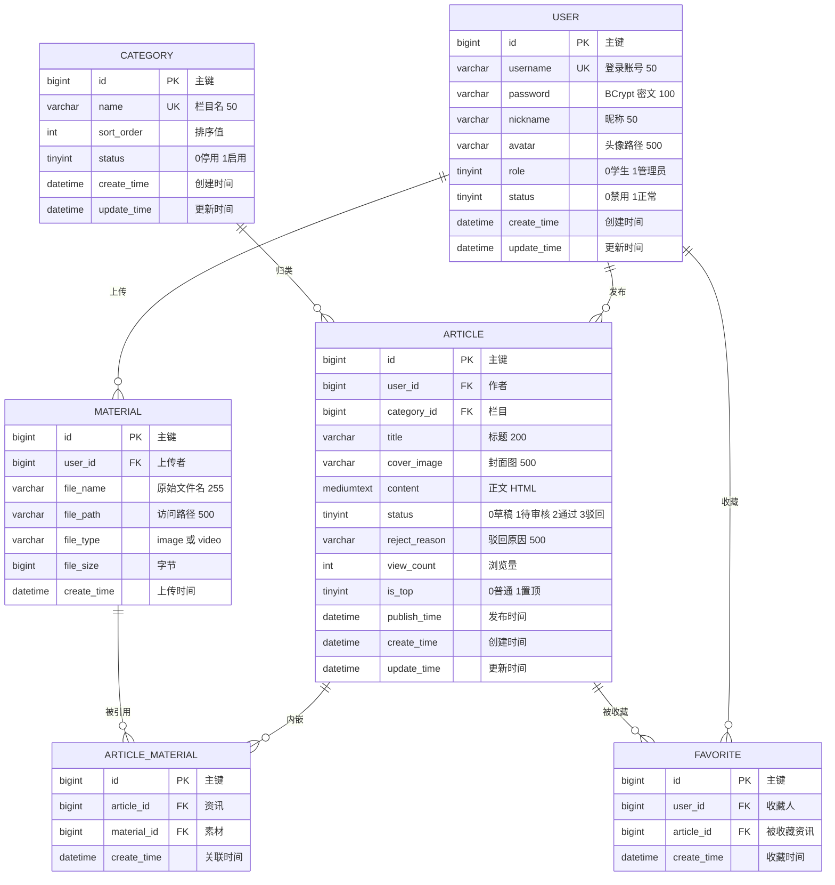

# 校园头条 数据库设计说明

> 配套脚本：[`src/main/resources/sql/schema.sql`](../src/main/resources/sql/schema.sql)
> DBMS：MySQL 8.0.44 ｜ 引擎：InnoDB ｜ 字符集：utf8mb4 / utf8mb4_0900_ai_ci

---

## 一、设计范围

| 业务功能 | 支撑表 |
| --- | --- |
| 用户注册登录 | `user` |
| 素材管理（图片 / 视频上传） | `material` |
| 资讯发布（草稿 / 提交审核 / 通过 / 驳回） | `article` |
| 资讯浏览（首页列表、详情页） | `article` + `category` |
| 资讯分类（栏目） | `category` |
| 收藏 | `favorite` |
| 资讯内嵌素材 | `article_material` |

设计原则：

1. 所有表使用 `bigint` 自增主键 `id`，避免业务主键变更带来的连锁影响。
2. 状态字段统一用 `tinyint`，取值含义写在列 `COMMENT` 里，不用字符串枚举（省空间、便于索引）。
3. 表名、列名避开 MySQL 保留字（`order` → `sort_order`，`desc` → 不使用，`user` 为非保留关键字可用）。
4. 核心表 `article`、`user`、`category` 带 `create_time` / `update_time`，由数据库自动维护，业务代码无需手填。
5. 按评审要求保留**物理外键**（`FOREIGN KEY`），同时用应用层校验兜底，保证报告里的关系图与库结构一致。

---

## 二、E-R 关系描述

系统共 6 个实体、6 组联系：

1. **用户 — 资讯（1 : N）**
   一个用户可以发布多篇资讯，一篇资讯只属于一个作者。`article.user_id → user.id`。
   作者被删除时其资讯一并删除（`ON DELETE CASCADE`），避免出现无主数据。

2. **用户 — 素材（1 : N）**
   一个用户可以上传多个素材（图片 / 视频），`material.user_id → user.id`。

3. **栏目 — 资讯（1 : N）**
   一个栏目下可以有多篇资讯，一篇资讯归属一个栏目。`article.category_id → category.id`，
   外键采用 `ON DELETE SET NULL`：栏目被删除时资讯不删除，只是变为「未分类」，保护已有内容。

4. **资讯 — 素材（M : N，通过 `article_material`）**
   一篇资讯可内嵌多个素材（多图、图文混排、视频），同一个素材也可以被多篇资讯复用。
   关联表用唯一索引 `(article_id, material_id)` 防止重复关联。

5. **用户 — 资讯（M : N，收藏）**
   通过 `favorite` 表实现，唯一索引 `(user_id, article_id)` 保证同一用户对同一篇资讯只收藏一次；
   取消收藏即删除记录，因此不需要状态字段。

6. **用户 — 栏目（无直接联系）**
   栏目由管理员在后台维护，普通学生只能选用，不参与资讯状态流转。

---

## 三、E-R 图（Mermaid）



---

## 四、资讯状态流转

```
                    ┌──────────────── 修改后重新提交 ────────────────┐
                    │                                              │
                    ▼                                              │
  [0 草稿] ──提交──> [1 待审核] ──通过──> [2 已通过]                 │
   ▲                    │                    │                     │
   │                    └────── 驳回 ────────┼──> [3 已驳回] ────────┘
   │                                         │
   └──────── 作者撤回 / 继续编辑 ─────────────┘
```

| 状态值 | 含义 | 前台可见 | 可编辑 | 说明 |
| --- | --- | --- | --- | --- |
| 0 | 草稿 | 否 | 是（仅作者） | 未提交，随便改 |
| 1 | 待审核 | 否 | 否 | 等待管理员处理 |
| 2 | 已通过 | 是 | 视权限 | 审核通过时写入 `publish_time`，进入首页列表 |
| 3 | 已驳回 | 否 | 是（仅作者） | 必须填写 `reject_reason`，修改后可重新提交回 1 |

约束：

- 学生只能把状态从 `0/3` 改成 `1`（提交审核），**不允许直接改成 `2`**，否则审核形同虚设。
- `publish_time` 只在 `0/1/3 → 2` 时写入，驳回后不清空（保留首次通过时间）还是清空，取决于业务约定；
  本项目约定**驳回时清空 `publish_time`**，重新通过时重新赋值，保证首页排序反映最新发布时间。
- 权限校验应放在 Service 层，配合 `LoginInterceptor` 拦截未登录请求。

---

## 五、数据字典

### 5.1 user（用户表）

| 字段名 | 类型 | 长度 | 主键 | 外键 | 允许空 | 说明 |
| --- | --- | --- | :---: | :---: | :---: | --- |
| id | bigint | 20 | ✔ | | 否 | 主键ID，自增 |
| username | varchar | 50 | | | 否 | 登录账号，唯一索引 `uk_username` |
| password | varchar | 100 | | | 否 | BCrypt 加密后的 60 位密文，禁止明文 |
| nickname | varchar | 50 | | | 是 | 昵称，展示用 |
| avatar | varchar | 500 | | | 是 | 头像访问路径 |
| role | tinyint | 4 | | | 否 | 角色：0-学生，1-管理员，默认 0 |
| status | tinyint | 4 | | | 否 | 账号状态：0-禁用，1-正常，默认 1 |
| create_time | datetime | — | | | 否 | 创建时间，默认 CURRENT_TIMESTAMP |
| update_time | datetime | — | | | 否 | 更新时间，ON UPDATE 自动刷新 |

索引：主键 `id`；唯一索引 `uk_username(username)`。

### 5.2 article（资讯表）

| 字段名 | 类型 | 长度 | 主键 | 外键 | 允许空 | 说明 |
| --- | --- | --- | :---: | :---: | :---: | --- |
| id | bigint | 20 | ✔ | | 否 | 主键ID，自增 |
| user_id | bigint | 20 | | ✔ user.id | 否 | 作者ID，作者删除时级联删除 |
| category_id | bigint | 20 | | ✔ category.id | 是 | 栏目ID，栏目删除时置为 NULL |
| title | varchar | 200 | | | 否 | 标题 |
| cover_image | varchar | 500 | | | 是 | 封面图路径 |
| content | mediumtext | 16MB | | | 是 | 正文，HTML 富文本 |
| status | tinyint | 4 | | | 否 | 0-草稿，1-待审核，2-已通过，3-已驳回，默认 0 |
| reject_reason | varchar | 500 | | | 是 | 驳回原因，status=3 时必填 |
| view_count | int | 11 | | | 否 | 浏览量，默认 0 |
| is_top | tinyint | 4 | | | 否 | 是否置顶：0-否，1-是，默认 0 |
| publish_time | datetime | — | | | 是 | 发布时间，审核通过时写入 |
| create_time | datetime | — | | | 否 | 创建时间 |
| update_time | datetime | — | | | 否 | 更新时间，自动刷新 |

索引：`idx_article_user(user_id)`、`idx_article_category(category_id)`、
`idx_article_status_publish(status, publish_time)`（首页列表主查询）、`idx_article_top(is_top)`。

### 5.3 material（素材表）

| 字段名 | 类型 | 长度 | 主键 | 外键 | 允许空 | 说明 |
| --- | --- | --- | :---: | :---: | :---: | --- |
| id | bigint | 20 | ✔ | | 否 | 主键ID，自增 |
| user_id | bigint | 20 | | ✔ user.id | 否 | 上传者ID，用户删除时级联删除 |
| file_name | varchar | 255 | | | 否 | 原始文件名，如 `运动会.jpg` |
| file_path | varchar | 500 | | | 否 | 访问路径，如 `/upload/image/2026/10/xxx.jpg` |
| file_type | varchar | 20 | | | 否 | `image` 图片 / `video` 视频 |
| file_size | bigint | 20 | | | 否 | 文件大小（字节），默认 0 |
| create_time | datetime | — | | | 否 | 上传时间，默认 CURRENT_TIMESTAMP |

索引：`idx_material_user(user_id)`、`idx_material_type(file_type)`。

### 5.4 category（栏目表）

| 字段名 | 类型 | 长度 | 主键 | 外键 | 允许空 | 说明 |
| --- | --- | --- | :---: | :---: | :---: | --- |
| id | bigint | 20 | ✔ | | 否 | 主键ID，自增 |
| name | varchar | 50 | | | 否 | 栏目名称，唯一索引 `uk_name` |
| sort_order | int | 11 | | | 否 | 排序值，越小越靠前，默认 0 |
| status | tinyint | 4 | | | 否 | 0-停用，1-启用，默认 1 |
| create_time | datetime | — | | | 否 | 创建时间 |
| update_time | datetime | — | | | 否 | 更新时间 |

### 5.5 article_material（资讯-素材关联表）

| 字段名 | 类型 | 长度 | 主键 | 外键 | 允许空 | 说明 |
| --- | --- | --- | :---: | :---: | :---: | --- |
| id | bigint | 20 | ✔ | | 否 | 主键ID，自增 |
| article_id | bigint | 20 | | ✔ article.id | 否 | 资讯ID，级联删除 |
| material_id | bigint | 20 | | ✔ material.id | 否 | 素材ID，级联删除 |
| create_time | datetime | — | | | 否 | 关联建立时间 |

索引：唯一索引 `uk_article_material(article_id, material_id)`、`idx_am_material(material_id)`。

### 5.6 favorite（收藏表）

| 字段名 | 类型 | 长度 | 主键 | 外键 | 允许空 | 说明 |
| --- | --- | --- | :---: | :---: | :---: | --- |
| id | bigint | 20 | ✔ | | 否 | 主键ID，自增 |
| user_id | bigint | 20 | | ✔ user.id | 否 | 收藏人ID，级联删除 |
| article_id | bigint | 20 | | ✔ article.id | 否 | 被收藏资讯ID，级联删除 |
| create_time | datetime | — | | | 否 | 收藏时间 |

索引：唯一索引 `uk_favorite_user_article(user_id, article_id)`、`idx_favorite_article(article_id)`。

---

## 六、外键与删除策略

| 外键 | 从表.列 → 主表.列 | ON DELETE | 理由 |
| --- | --- | --- | --- |
| fk_article_user | article.user_id → user.id | CASCADE | 作者注销，其资讯无意义 |
| fk_article_category | article.category_id → category.id | SET NULL | 栏目下线不应删稿，转为未分类 |
| fk_material_user | material.user_id → user.id | CASCADE | 用户删除，素材随之清理 |
| fk_am_article | article_material.article_id → article.id | CASCADE | 关联记录无独立价值 |
| fk_am_material | article_material.material_id → material.id | CASCADE | 同上 |
| fk_favorite_user | favorite.user_id → user.id | CASCADE | 收藏记录无独立价值 |
| fk_favorite_article | favorite.article_id → article.id | CASCADE | 资讯删除，收藏失效 |

---

## 七、代码对应关系

| 表 | 实体类（`com.campus.headlines.entity`） | Mapper（`com.campus.headlines.mapper`） |
| --- | --- | --- |
| user | `User` | `UserMapper` |
| category | `Category` | `CategoryMapper` |
| material | `Material` | `MaterialMapper` |
| article | `Article` | `ArticleMapper` |
| article_material | `ArticleMaterial` | `ArticleMaterialMapper` |
| favorite | `Favorite` | `FavoriteMapper` |

映射规则：MyBatis-Plus 默认驼峰转下划线（`GlobalConfig.DbConfig.tableUnderline = true`），
因此 `createTime → create_time`、`isTop → is_top` 无需注解。
`Article` 类内定义了 `STATUS_DRAFT/PENDING/APPROVED/REJECTED` 常量，业务代码不要写魔法数字。

---

## 八、验证记录

脚本与实体已在 MySQL 8.0.44 实测：

- 6 张表、7 个外键全部创建成功
- 实体插入/查询/更新/删除全部通过，`create_time` 由数据库默认值填充
- 状态流转 `0 → 1 → 2 → 3` 实测可写，`publish_time`、`reject_reason` 正确落库
- 重复收藏被唯一索引拒绝（`Duplicate entry`）
- 分页插件生效：`SELECT ... LIMIT ?`，`total/pages` 计算正确
- 删除用户后，其资讯、素材、收藏、关联记录均被级联清理
